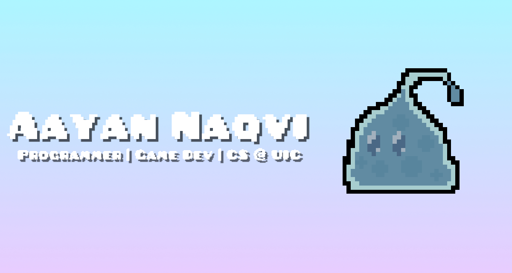

# Hi! I'm Aayan 👋🏾
### Computer Science Student @ UIC | Game & Systems Developer (Unity / C# & Godot / GDScript)

  

Im a computer science student at the University of Illinois Chicago (UIC) obsessed with making video games. Ever since I was a kid, I've been obsessed with them. Some technologies and languages I work with include Unity, Godot, C#/C++, and Java. You can find my published games on my [GameJolt](https://gamejolt.com/@MusslimanDev/games) page! You can also check out repos filled with the scripts I created for my games.

# Connect with me:
* 
* 
* 

<!--
**AayanNaqvi/AayanNaqvi** is a ✨ _special_ ✨ repository because its `README.md` (this file) appears on your GitHub profile.

Here are some ideas to get you started:

- 🔭 I’m currently working on ...
- 🌱 I’m currently learning ...
- 👯 I’m looking to collaborate on ...
- 🤔 I’m looking for help with ...
- 💬 Ask me about ...
- 📫 How to reach me: ...
- 😄 Pronouns: ...
- ⚡ Fun fact: ...
-->
